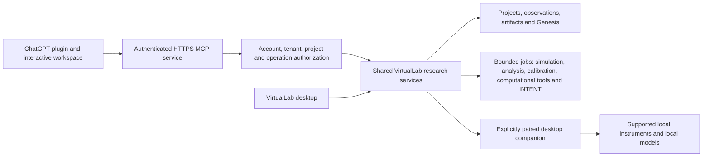

# Full VirtualLab in ChatGPT

The intended product is a complete research workspace, with the existing VirtualLab scientific engine and evidence semantics available through ChatGPT. The BSA read-only adapter is a transport test, not the intended release scope.

A searchable listing and a full application are separate deliverables. A manifest cannot turn the current Qt desktop into an embedded web application. ChatGPT components use web UI; native Qt controls need web counterparts or a paired desktop experience. The owner selected **both**: an interactive ChatGPT workspace and a paired full desktop application, sharing projects and the research engine. The existing developing web client at `https://globalintentcompany.space/virtual-lab/demo` is the browser fallback; reuse it rather than create a separate competing product.

## Proposed architecture

The web and desktop clients should operate on the same service contracts and persisted records. A future shared server must own transactional writes; desktop and cloud processes must not independently open and write the same SQLite directory. Reuse scientific implementations rather than copy the calculations into prompts or inventing results.

## Full application coverage

`capability-parity.json` is the authoritative inventory for this work. It includes:

1. Projects, experiments, notebooks, plans, conclusions and portable study exchange.
2. MS imports, spectrum inspection, original/normalized data, integrity, reproducibility, review and hashed reports.
3. Simulation controls, actual runs, saved results and cancellation.
4. Analysis plots, trajectories, distributions and sensitivity summaries.
5. Saved-run comparison with compatible models/time spans.
6. Numerical verification and certificates.
7. Biological objects and their current experimental limitations.
8. Calibration and maturation validation workflows.
9. Computational biology, provider requirements and artifacts.
10. RHO reference visualization with its actual reference scope.
11. Curated/project evidence and evidence classifications.
12. Genesis provenance and artifact verification.
13. INTENT policies, prediction, separately measured outcomes, trusted reviews, replay, independent holdout, candidates, evaluation, manual promotion and rollback.
14. Instrument discovery, status and supported acquisition through an explicitly paired companion.
15. Optional AI/provider configuration and model resource management.
16. Settings, privacy, sharing, permissions and performance controls.

MS/MS compound identification is currently unavailable in the desktop registry and is not promised by this parity target. Experimental tools stay experimental in the plugin. A complete interface does not establish biological or laboratory validity.

## Implementation order

### A. Shared research service boundary

- [ ] Separate Qt presentation/signals from reusable project/experiment operations.
- [ ] Define versioned requests and responses with owned project/experiment/artifact IDs.
- [ ] Reuse the existing scientific functions, MS service, signed INTENT controller and artifact checks.
- [ ] Add a single bounded job interface with cancel/status/resume semantics for expensive operations.
- [ ] Define upload/download handles rather than exposing arbitrary local paths to tool calls.
- [ ] Preserve original inputs, immutable results, evidence labels and Genesis audit linkage.

### B. Accounts, sharing and server ownership

- [ ] Verified authentication and MCP OAuth appropriate to the chosen deployment.
- [ ] Tenant/project membership checked on every operation and artifact access.
- [ ] Server-owned writes and committed-change events, reconnect/replay and revision conflicts.
- [ ] Independent assistant, prediction, learning, cloud and sharing permissions.
- [ ] Step-up authorization/confirmation for consequential actions; tool hints are not grants.
- [ ] Scope artifact downloads and omit credentials, private filesystem paths and unrelated records.

### C. Full interactive workspace

- [ ] Web navigation matching all installed desktop workspaces and disciplines.
- [ ] Project library and notebook persistence.
- [ ] Working spectrum, analysis, comparison and numerical views backed by real results.
- [ ] Working biological, calibration, computational and reference views with truthful availability.
- [ ] Evidence/provenance views and actual hashed report/study outputs.
- [ ] INTENT review/checkpoint monitor and independent controls.
- [ ] Settings and job/resource monitor.
- [ ] MCP Apps host bridge, exact resource CSP, accessible layouts and desktop/mobile acceptance.

### D. Desktop companion parity

- [ ] Explicit pairing to the selected user/device/instance.
- [ ] Supported instrument status/acquisition with existing session and preservation checks.
- [ ] Local model routing, cancel/unload and resource limits.
- [ ] Clear disconnected state; no fabricated device/model success.
- [ ] No arbitrary shell/Python execution endpoint and no silent external fallback.
- [ ] Test mixed desktop/plugin edits without corrupting research records.

### E. Full-product acceptance and directory submission

- [ ] Every workspace in `capability-parity.json` passes its real workflow acceptance.
- [ ] Five positive and three negative review cases run from ChatGPT, with actual tool/argument/result evidence.
- [ ] Dedicated review account and sample data; reviewers need no access to real laboratory accounts.
- [ ] Confirm rights to redistribute any bundled software/assets and publicly use the review data.
- [ ] Approved privacy/terms/support/product pages on verified domains.
- [ ] Stable public HTTPS service with operational ownership and required auth.
- [ ] Full-plugin walkthrough with an accessible review URL.
- [ ] Publisher verification, portal package/tool scans, review, approval and explicit publication.

## Existing protections remain

Predictions must never become measured truth. INTENT training still needs the appropriate project grant and independently signed measured outcomes, with a frozen independent holdout and manual candidate promotion. Device access needs pairing and supported permissions. Numerical accuracy is not biological validity. These are shared service checks, not instructions that a language model can waive.

The full application should be released as one coherent plugin after acceptance. The snapshot proof of concept may continue to support engineering tests without being published as the final VirtualLab product.

## First shared-engine implementation

The Qt-independent services now live in `virtual_lab/application/`, with compatibility imports for the desktop. Projects, notebook records, MS CSV intake/inspection, actual numerical jobs, comparison and a cursor-based project change feed have a tested local engine boundary. Both desktop- and web-labeled in-process adapters use the same engine and saved records.

This does not connect the live website or turn the desktop into a remote API client yet. HTTP/OAuth, tenant authorization, companion pairing, web/ChatGPT UI parity and the remaining workstation bindings are still implementation gates. See [shared engine contract](../../docs/shared-research-engine.md).
